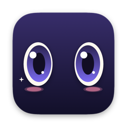
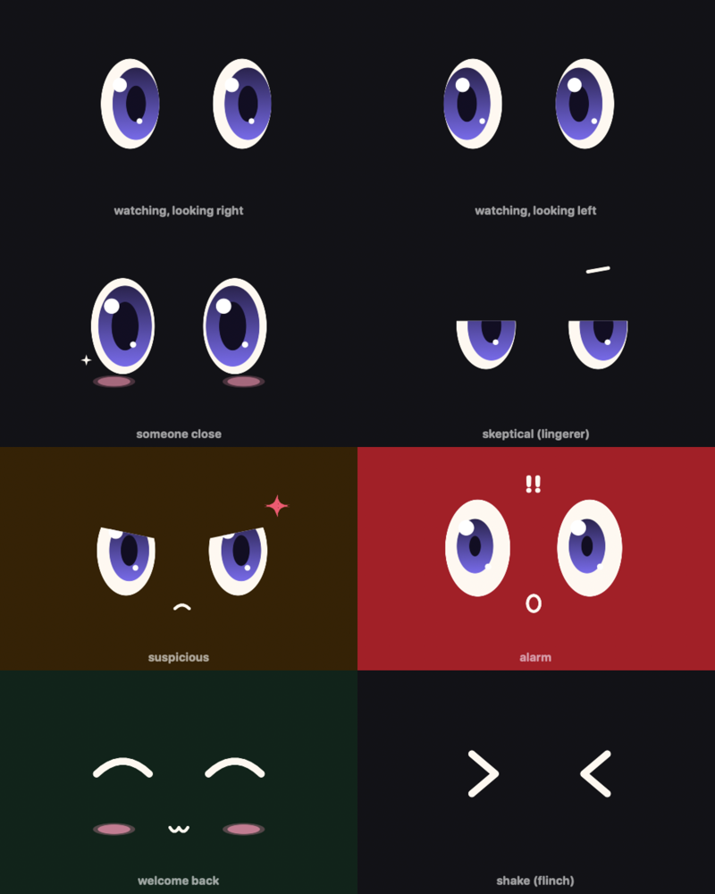
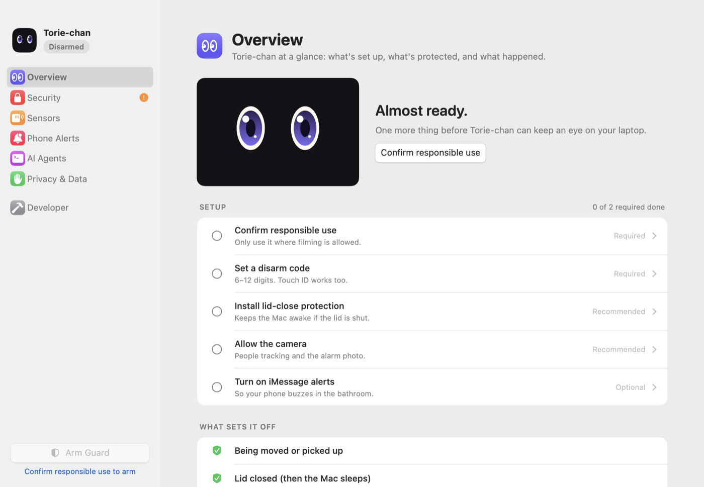
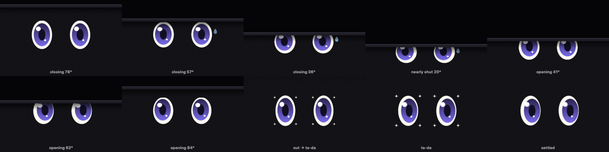

<p align="center">
  
</p>

<h1 align="center">Torie-chan</h1>

<p align="center">
  A kawaii laptop guard for macOS.<br>
  Tell your AI agent "watch my laptop, back in 5" and Torie-chan keeps an eye on it.
</p>

<p align="center">
  <a href="https://github.com/llmer/torie-chan/releases/latest">Download</a> ·
  <a href="#getting-started">Getting started</a> ·
  <a href="#how-it-works">How it works</a> ·
  <a href="SECURITY.md">Security</a> ·
  <a href="CONTRIBUTING.md">Contributing</a>
</p>

Stepping away from your laptop at a coffee shop? Arm Torie-chan (or ask Claude Code or Codex to). Your
screen fills with a pair of big eyes that follow people walking by. If anyone moves the laptop, closes the
lid, unplugs the charger or messes with it, she warns them out loud, then sounds a siren and texts your
iPhone over iMessage. Only you can disarm her, with your code or Touch ID.

<p align="center">
  
</p>

## What it is, and what it isn't

Torie-chan is a **deterrent and an early warning**, not a lock. It makes walking off with your laptop loud,
awkward and photographed, and it tells you right away. It can't stop someone who's determined: holding the
power button always turns a Mac off (Torie-chan sounds the alarm the moment it's pressed, but she can't keep
the Mac running). Keep Find My turned on too.

The camera notices people walking by, on your Mac, and records nothing. A single photo is saved only if the
alarm goes off. Rules about cameras vary from place to place: use it where filming is allowed, and never in
restrooms or changing areas.

## Requirements

- An Apple Silicon Mac (the motion sensor is Apple Silicon only) on macOS 14 or later
- Optional: Messages signed in to iMessage, for phone alerts
- Optional: Claude Code or Codex, to arm it by asking

## Getting started

1. **Download** the latest `Torie-chan-<version>.dmg` from
   [Releases](https://github.com/llmer/torie-chan/releases/latest), open it, and drag Torie-chan into
   Applications. Open it from there. Releases are signed and notarized, so it opens like any other app.
2. Torie-chan lives in the menu bar (the eyes icon). Her Settings window opens with a short setup checklist:

<p align="center">
  
</p>

   - **Confirm** you'll only use it where filming is allowed.
   - **Set a disarm code** (6-12 digits). Touch ID works too.
   - **Lid-close protection**: click Install, then turn on Torie-chan in System Settings > General > Login Items.
     Without it, closing the lid sounds the alarm but then the Mac goes to sleep.
   - **Camera**: click Allow. Torie-chan never asks mid-arm, so a permission prompt can't hide behind her screen.
   - Optional, **Phone Alerts**: turn on iMessage alerts, enter your iPhone number or Apple ID email, and
     send a test. If a message to yourself arrives without a notification, use another number or email you own.
3. Try **Sensors > Test motion**: tap the table, type, nudge the laptop, and watch what would set it off.
4. **Arm it** from the sidebar or the menu bar, or connect your AI agent (Settings > AI Agents has the command):

```sh
claude mcp add torie-chan -- "/Applications/Torie-chan.app/Contents/MacOS/bg-mcp"
codex  mcp add torie-chan -- "/Applications/Torie-chan.app/Contents/MacOS/bg-mcp"
```

   Then just say *"watch my laptop, back in 5."* Agents can arm Torie-chan and read what happened, but
   they can never disarm her.

When you close the lid, Torie-chan ducks under it like she's peeking out from under a bed:

<p align="center">
  
</p>

Torie-chan updates herself: she checks once a day and asks before installing (Settings > Overview >
Updates). Updates are signed, and she never updates while she's guarding.

### Building from source

```sh
make install        # builds, signs with your Apple Development identity, copies to /Applications, launches
```

See [CONTRIBUTING.md](CONTRIBUTING.md) for the full developer setup.

## How it works

```
Claude / Codex ──stdio MCP──> bg-mcp ──unix socket──> Torie-chan.app ──XPC lease──> bg-helper (root)
                               (in bundle)            eyes · sensors · alarm             pmset disablesleep
```

### What sets it off

| Signal | Source | Reaction |
|---|---|---|
| Bumps, sliding, rotation | Accelerometer + gyro (Apple Silicon SPU HID, undocumented, 100 Hz) | Builds an *agitation score* that drains over about 2s: warning at 1, alarm at 3 |
| Grabbed / lifted | Single jolt above 0.6g, or tilt above 18° | Alarm immediately |
| Lifted level / slow drag | Camera: whole-scene shift vs. a reference frame | Adds agitation; alarm if still shifted |
| Lid closed / screen lowered | `AppleClamshellState`, hinge-angle sensor | Warning with a 1.5s fuse |
| Charger unplugged | IOKit power sources | Warning; alarm if still unplugged |
| Headphones / dongle plugged in | Wired audio device fingerprint (Bluetooth ignored) | Warning; alarm if still there |
| Screen locked, power button, shutdown, user switch | System notifications | Alarm |
| Guard screen loses focus for over 2s, new display | Kiosk window | Alarm / warning |
| Camera covered, motion sensor goes silent | Scene brightness, sample gap | Warning; alarm if it persists |
| App force-quit / crash | Helper sees the XPC connection drop without a disarm | Relaunches the app, which comes back up in alarm |
| Wrong codes | 3 free tries, then lockouts of 10s, 20s, 40s… (survive relaunch) | Alarm |

**Leeway:** a single bump only jiggles the eyes. Any key, click or trackpad touch on the guard screen
gives 10 seconds where small motion counts a quarter as much. If a warning just started because the owner
touched the laptop, their first key press cancels it. A vibrating table is learned as background noise.

**Siren:** the audio engine is pinned to the built-in speakers (`BuiltInSpeakerDevice`), not the system
default. AirPods or a headphone dongle can't reroute it, it rebuilds itself if audio reconfigures, and volume
and mute are re-asserted every 300ms. Spoken warnings go to the speakers too, not your AirPods.

**Sleep:** IOPM assertions stop idle sleep. The root helper runs `pmset disablesleep 1` on a lease: the app
checks in every 5s, and the helper restores sleep after 30s of silence, 60s after an unrecovered crash, at boot,
and on a critical thermal state with the lid closed.

### Character
Torie-chan: a pair of kawaii eyes (cream sclera, violet gradient iris, fixed sparkle highlights) drawn as flat
vector shapes, with no emoji or bitmap assets. Every parameter moves on a spring and the view redraws at the display's
refresh rate, so motion is smooth at 120 Hz. Gaze follows people through a One Euro filter, holds through brief
detection dropouts, and the whole face leans slightly toward where it's looking.

Expressions: sleepy closed arcs with drifting z's (disarmed), watching, bigger and sparkly with blush when someone
is close, a flat-lidded side-eye with a brow dash at lingerers ("I'm guarding this for my friend."), angled lids
with a vector anger mark when suspicious, wide shocked eyes with "!!" and an O mouth in the alarm (the eyes stay open
in every guarding state, since eye contact is what deters), and closed happy arcs with blush on welcome-back.
Reactions: blink, wink, boing, and a short > < flinch.

The lid is "under the bed": as it closes, a dark underside with a rail comes down from the top, and the eyes duck
under its edge and peer up and out from the gap, with a nervous sweat drop. When it opens, they creep back out
looking around, then pop up with a sparkle burst.

While warning or alarming, a mirrored "You're on camera" preview appears. Disarming gets happy eyes and a
debrief: "7 min · 14 walked by · 2 got close · nobody touched it".

## MCP tools

| Tool | What it does |
|---|---|
| `arm_guard` | Launch and arm. `countdown_seconds` (5–120, default 10), `expected_back_minutes`, `note` (60 chars). Returns what's protected and any gaps |
| `guard_status` | State, protections, gaps, people, lid/charger |
| `post_update` | Show a progress line on the guard screen while armed (100 chars); included in the debrief |
| `last_session` | Current or last session summary for the welcome-back debrief |
| `get_events` | Detailed log. Alarm photos are flagged but their paths are never shared |

There is **no disarm tool**, by design.

## Privacy

- Face *detection* only, at 3–8 fps and 640×480, processed in memory. No face recognition or face templates.
  Owner recognition was considered and rejected (spoofable, and a biometric-law risk).
- One photo per alarm, **encrypted on disk** with a key kept in your keychain, kept 7 days by default (configurable).
  You view it inside Torie-chan. It's only sent if you turn on "Include the alarm photo" for iMessage alerts
  (end-to-end encrypted, off by default); that copy is deleted from the Mac after 10 minutes. No third-party services.
- The event log keeps 30 days. Settings › **Delete All Data** wipes everything, including the photo key.
- A standing notice on the guard screen tells passers-by what the camera does and doesn't do.
- Agent-supplied text (notes, updates) is sanitized and length-capped. Agents are told log text is data, not instructions.

## Files

- `~/Library/Application Support/Torie-chan/`: `events.jsonl`, `last_session.json`, `Snapshots/` (encrypted alarm photos), `armed.json` (exists only while armed)
- `/var/log/toriechan-helper.log`: helper log

## Releasing

`.github/workflows/build.yml` runs the tests and builds the app on every push and pull request. Pushing a tag
publishes a release with the disk image and its SHA-256:

```sh
git tag v0.1.0 && git push origin v0.1.0
```

For builds that open cleanly on any Mac (and support lid-close protection), add these as secrets of the
**`release` environment** (Settings > Environments > release). Only `v*` tags can deploy to that environment,
so branch and pull request builds can never read them:

| Secret | What it is |
|---|---|
| `DEVELOPER_ID_P12` | base64 of your exported **Developer ID Application** certificate (`base64 -i cert.p12 \| pbcopy`) |
| `DEVELOPER_ID_P12_PASSWORD` | the password you set when exporting it |
| `NOTARY_KEY_P8` | base64 of an App Store Connect API key (.p8) with Developer access |
| `NOTARY_KEY_ID` | that key's ID |
| `NOTARY_ISSUER` | the Issuer ID from App Store Connect > Users and Access > Integrations |

Without them the workflow still publishes an ad-hoc signed build, clearly labeled as unsigned.

Locally: `SIGN_IDENTITY="Developer ID Application: …" NOTARY_PROFILE=<profile> make dmg`.

## Development

```sh
swift build          # compile-check all targets (open Package.swift in Xcode to edit)
make app             # build/Torie-chan.app
make mcp-test        # MCP handshake smoke test
make test            # unit tests (motion detection, gaze filter, text, eyes)
make icon            # regenerate Resources/AppIcon.icns from the eye renderer
make dmg             # build/Torie-chan-<version>.dmg
SIGN_IDENTITY="Developer ID Application: …" NOTARY_PROFILE=bg make app   # signed + notarized for distribution
```

Camera and keychain access need the signed `.app`; `swift run` won't have permission.

## Not done yet

- **Auto-update (Sparkle):** needs a place to host the appcast and update archives.
- **Swift 6 language mode:** the code runs in Swift 5 mode, so data-race checking is off.
- **Data-protection keychain:** needs a provisioning profile.
- **Full sensor fusion:** a Mahony filter, double-integrated lift height and band-split filtering. The agitation
  score, adaptive noise floor and camera scene check cover most of this today.

## Contributing

Pull requests are welcome. See [CONTRIBUTING.md](CONTRIBUTING.md) for setup, the project layout, and the
Conventional Commits format for PR titles.

## License

[MIT](LICENSE)
